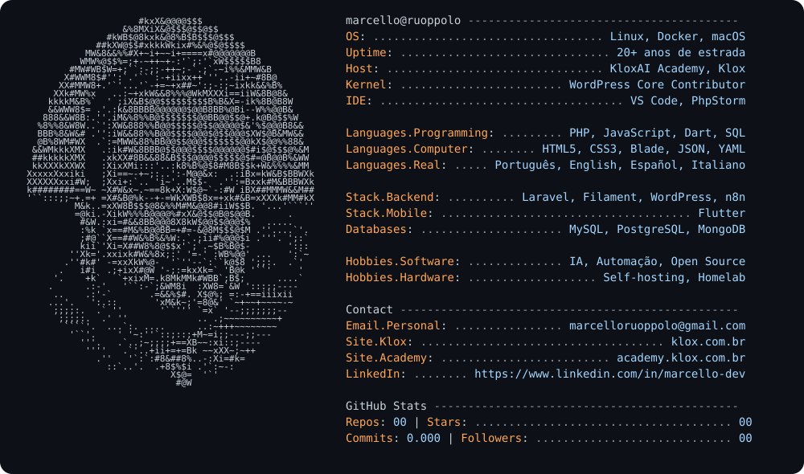

<a href="https://github.com/maruoppolo">
  <picture>
    <source media="(prefers-color-scheme: dark)" srcset="dark_mode.svg">
    <source media="(prefers-color-scheme: light)" srcset="light_mode.svg">
    
  </picture>
</a>

---

### Sobre mim

Senior Software Engineer com mais de 20 anos de experiência em desenvolvimento e arquitetura de sistemas web e mobile de alta performance. WordPress Core Contributor e entusiasta de IA e automação. Fundador da **[KloxAI Academy](https://academy.klox.com.br)** e da **[Klox](https://klox.com.br)**.

### Open source

- **Protector**: plugin WordPress que protege o painel admin com uma senha passada pela URL.
- **Analyticator**: plugin WordPress para inserir códigos de rastreamento (Google Analytics, SmartLook e Hotjar).

### Stack

